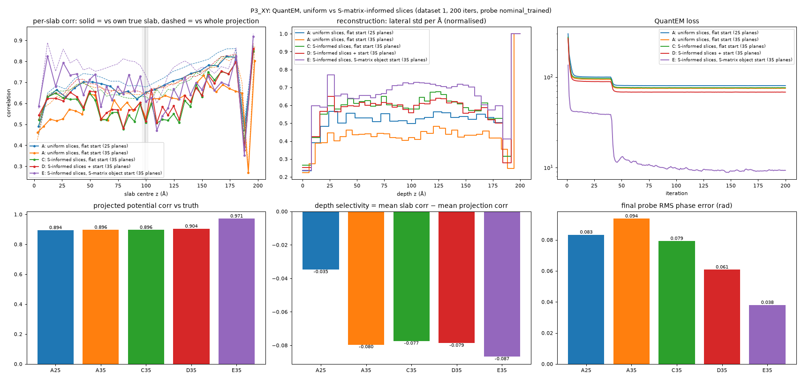
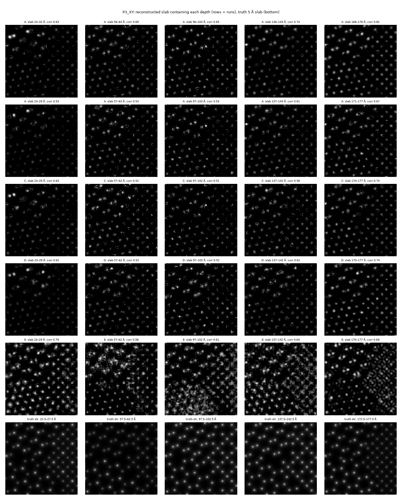
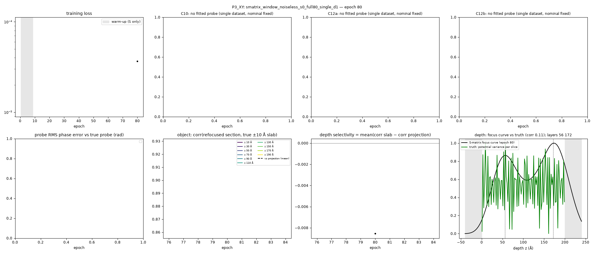
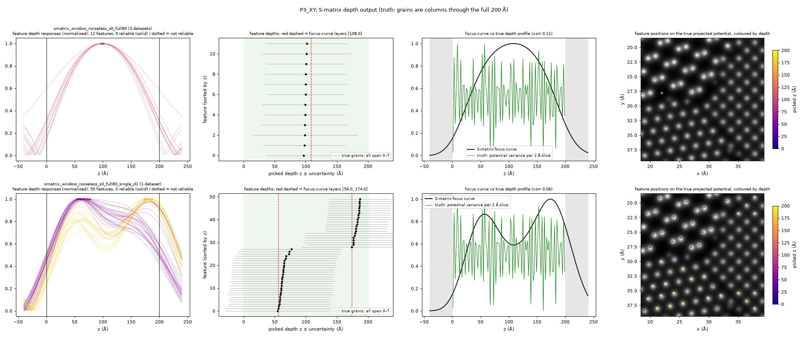

# QuantEM on poly-Si P3_XY: uniform vs S-matrix-informed slices and starts

Specimen `P3_XY` of `configs/poly_si_3grain.yaml`, noiseless window data. Five QuantEM reconstructions of the same
dataset are compared. They differ only in where the slices go and in what the object starts from. Each run is checked
against the ground truth. All S-matrix inputs come from the joint S-matrix + probe fit
`smatrix_window_noiseless_s0_full80`.

**Main result.** Starting QuantEM from the S-matrix's recovered object (arm E) gives a much better reconstruction
than every other arm: 8x lower loss, projected-potential correlation 0.971 vs 0.894–0.904, and half the probe error.
Placing slices by the S-matrix depth candidates (arm C) makes no difference. No arm recovers depth structure, which is
expected: the three grains of P3_XY are columns through the full thickness. An S-matrix fitted on the same single
dataset as QuantEM (section 5) keeps a good lateral image (corr 0.934) but cannot fit the probe. It also invents two
false depth layers, so the S-matrix's probe and depth accuracy depend on having three defocus datasets.

**Probe handoff (section 6).** Handing QuantEM the three-focus S-matrix *probe* as well as its object gives the best
run so far (E-Sf: probe kept fixed, projected corr 0.972, loss 8.27, probe error 0.004 rad). The gain over the
nominal-probe E is mostly in loss and speed (iteration 40: 12.6 vs 38.6); the projected image barely changes
(0.9713 → 0.9721). Training the probe in QuantEM from the S-matrix start makes the probe worse (0.004 → 0.063 rad).
With 10 % of the patterns held out (section 6.1) the S-matrix probe still lowers the held-out loss by 8 %.

## 1. Data and specimen

| | |
|---|---|
| specimen | 200 Å polycrystalline Si, 3 grains: [001] 0°, [110] 17°, [111] 41° in-plane (`polysi.py`, unrelaxed periodic Voronoi) |
| grain geometry | Voronoi metric `[1, 1, 0]`: boundaries are vertical, so every grain runs through the full 0–200 Å depth (no depth structure) |
| cell | 57.6 × 57.6 × 200 Å, 32 066 atoms |
| microscope | 300 kV, 20 mrad aperture with 2 mrad soft edge |
| scan | 53 × 53 positions, 0.4 Å step (21 × 21 Å field) |
| detector | window variant: \|FFT\|² of the 96 × 96 exit-wave window, 0.2 Å pixel; noiseless |
| defocus datasets | nominal C10 = −166.7 / −100 / −33.3 Å; true − nominal (C10, C12a, C12b) = (0, 0, 0) / (+12, +6, −4) / (−10, −3, +5) Å |

## 2. Methods

### 2.1 S-matrix stage (input to arms C, D, E)

`run_benchmark.py smatrix` fits the S-matrix (1313 beams) and the probe aberrations of all three defocus datasets
together (`simple_joint.py`, PyTorch, Adam). Settings: 80 epochs, batch 16, lr_S 0.02, simultaneous S and probe
updates, trainable C10/C12a/C12b on datasets 1 and 2. Dataset 0 is held at its nominal values to fix the gauge. It
used all 8427 patterns and took 3.2 h on a T4.

| S-matrix result | value |
|---|---|
| dataset 1 aberration error (C10, C12a, C12b) | +0.09, +0.07, −0.09 Å (start −12, −6, +4) |
| dataset 2 aberration error | −0.74, +0.08, −0.16 Å (start +10, +3, −5) |
| dataset 1 probe: overlap / RMS phase error | 0.999994 / 0.0035 rad |
| projected-potential estimate (phase of refocused wave at mid-depth) vs truth | corr 0.944, but slope 0.36 (about 3x too weak) |
| depth candidates | 12 lateral features at z = 96.6–101.6 Å, uncertainty ±61–85 Å, **none flagged reliable** |
| focus curve vs true depth profile | corr 0.15; one layer at 108 Å |

The candidate depths cluster at 100 Å because each feature is a column spanning 0–200 Å, whose centre is at T/2.
They carry no real depth information.

### 2.2 QuantEM stage (all arms)

`run_benchmark.py quantem` runs QuantEM (git 0f60f90) on **defocus dataset 1 only**. The installed QuantEM has no
multi-dataset reconstruction, so QuantEM sees one third of the data the S-matrix fit used.

| setting | value |
|---|---|
| object model | `ObjectPixelated`, `obj_type="potential"` (pixel arrays, one per slice, rad), positivity constraint |
| probe model | `ProbePixelated` (complex pixel array), initialised from the **nominal** aberrations (C10 = −100 Å) |
| forward model | multislice, amplitude loss |
| optimiser | iterative gradient descent (autograd + Adam); not a DIP / network model |
| schedule | 200 iterations, batch 64; iterations 1–40 object only (lr 5e-3), 41–200 object + probe (probe lr 1e-4) |
| object grid | 120 × 120 px at 0.2 Å (scan field + padding) |
| seed | 0 (one run per arm) |

### 2.3 Arms

| arm | slices | starting object |
|---|---|---|
| **A25** | 25 uniform, 8 Å | flat (1e-3 rad everywhere) |
| **A35** | 35 uniform, 5.71 Å | flat |
| **C** | 35 S-informed | flat |
| **D** | 35 S-informed | flat + 12 seeded candidate spots |
| **E** | 35 S-informed | the S-matrix's recovered object |

**S-informed slices** (`quantem_export.slice_grid`). Slice density along z = 1/16.7 Å⁻¹ baseline, plus a Gaussian
per candidate (centre = candidate depth, σ = its uncertainty, worth 2 extra slices), capped at 1/5 Å⁻¹. The specimen
is cut into equal-density slabs. Because the candidates are so broad, the result is 5.0 Å slabs from 52 to 147 Å,
widening to 8.2 Å at the surfaces:

```
0, 8.2, 15.7, 22.7, 29.2, 35.4, 41.2, 46.7, 52.0, 57.2, 62.2 ... (5.0 Å steps) ... 142.2, 147.3,
152.7, 158.3, 164.2, 170.4, 177.0, 184.1, 191.7, 200 Å
```

All 12 candidates fall in slabs 92.2–97.2 and 97.2–102.2 Å. The uniform arm A35 uses the same count (35) so the
comparison isolates placement.

**Slice-grid bug fixed during this work.** The original `slice_grid` made slabs a hair under the 5 Å minimum and then
merged them pairwise. The region with the most candidates therefore got the *thickest* slabs (10–15 Å around 87–137 Å)
and only 25 slabs in total. The fix rescales the candidate term so every slab holds exactly unit density. That gives
the 35-slab grid above; the existing tests pass. The A25 run used the old count (25) with uniform spacing, so it is
unaffected by the placement bug and is kept as a slice-count reference.

**D: seeded start** (`quantem_export.initial_potential`). Each of the 12 candidates adds a 0.45 Å Gaussian spot at
its (x, y), with total phase = its amplitude (0.64–0.98 rad), spread over the slabs by its depth Gaussian. With
σ ≈ 70 Å the spread is almost uniform: 2.2 % of a spot's phase goes to the surface slabs and 3.4 % to the 97–102 Å
slab, i.e. about 0.02–0.03 rad per slice. The hundreds of other Si columns start empty.

**E: S-matrix object start** (`run_benchmark.smatrix_object_init`, new):

1. Lateral: the S-matrix projected estimate. This is the phase of the refocused wave at 100 Å over the scan field
   (`refocused_phase.npy`, 105 × 105 px at 0.2 Å), 2-D unwrapped, 1st percentile set to 0, clipped ≥ 0. Pixel 0 is the
   first scan position, which is QuantEM object pixel 8; both sit at cell coordinate 18.4 Å (checked). Edge values
   fill the padding.
2. Depth: slab k receives the fraction of the S-matrix focus curve inside it.
3. Scale: the S-matrix estimate is about 3x too weak, so the code tries 8 scale factors. It keeps the one whose initial
   object has the lowest QuantEM forward loss on the measured data. The ground truth is not used.

| scale | 0.5 | 1 | 1.5 | 2 | **2.5** | 3 | 4 | 6 |
|---|---|---|---|---|---|---|---|---|
| initial QuantEM loss | 357 | 278 | 224 | 197 | **195** | 218 | 320 | 631 |

### 2.4 Evaluation (`plot_quantem.py`, `compare_quantem.py`)

The truth is the abTEM potential × σ (rad). For each reconstruction slab it is integrated over the slab's depth range,
sampled at the reconstruction pixels, and blurred to the 0.2 Å pixel; this follows `evaluate_reconstruction.py`. The
comparison covers the scan field only.

- **Projected:** sum of all slices vs the true projection. Reports correlation, least-squares slope (1 = right
  strength), RMSE after the fit, NRMSE = fitted RMSE / std, and FRC.
- **Per slab:** each slice is correlated against its own true slab ("slab corr") and against the whole true projection
  ("proj corr"). **Depth selectivity** = mean slab corr − mean proj corr. A value > 0 means the slices hold depth
  information beyond the projection.
- **Depth profile:** lateral std per Å of each slab, reconstruction vs truth.
- **Probe:** final vs true probe at the aperture beams, after removing piston and tilt. Reports overlap and RMS phase
  error. The same measure is used for the S-matrix probes.

## 3. Results

| arm | planes | final loss | projected corr | slope | RMSE (rad) | NRMSE | mean slab / proj corr | depth selectivity | depth profile corr | probe overlap | probe RMS (rad) | time |
|---|---|---|---|---|---|---|---|---|---|---|---|---|
| A25 | 25 | 80.4 | 0.894 | 0.80 | 0.70 | 0.45 | 0.689 / 0.724 | −0.035 | −0.06 | 0.9964 | 0.083 | 15 min |
| A35 | 35 | 75.0 | 0.896 | 0.81 | 0.70 | 0.44 | 0.597 / 0.677 | −0.080 | 0.02 | 0.9955 | 0.094 | 25 min |
| C | 35 | 76.2 | 0.896 | 0.80 | 0.70 | 0.44 | 0.600 / 0.677 | −0.077 | −0.01 | 0.9967 | 0.079 | 56 min* |
| D | 35 | 68.2 | 0.904 | 0.82 | 0.68 | 0.43 | 0.613 / 0.692 | −0.079 | 0.02 | 0.9980 | 0.061 | 26 min |
| **E** | 35 | **9.3** | **0.971** | **0.95** | **0.40** | **0.24** | 0.671 / 0.758 | −0.087 | 0.10 | **0.9992** | **0.038** | 56 min* |
| *S-matrix, for reference* | – | – | 0.944 (estimate) | 0.36 | – | – | – | – | 0.15 (focus curve) | 0.999994 | 0.0035 | 3.2 h |

\* C and E shared the GPU, which doubles wall time; the work per iteration is the same as A35/D.
Probe start for every arm: overlap 0.961, RMS 0.282 rad (nominal probe). FRC 0.5 crossing of the projection: about
1.6 Å⁻¹ for A–D, about 1.9 Å⁻¹ for E.





Per-run figures (`slices.png`, `projected.png`, `depth.png`, `probe.png`) and `metrics.json` are in
`results/quantem/poly_si_3grain/P3_XY/<run>/plots/`.

## 4. Findings

1. **Slice placement from the S-matrix does nothing here (C ≈ A35).** Every number is within noise. The candidates'
   ±61–85 Å uncertainty makes the S-informed grid just "slightly finer in the middle".
2. **Slice count (A25 vs A35) changes the loss, not the object.** 35 slices fit the data better (75 vs 80) but give
   the same projection (0.896 vs 0.894). Each individual slice is noisier: slab corr drops from 0.69 to 0.60.
3. **The 12-spot seeded start (D) helps a little.** Loss 68 vs 75–76, probe RMS 0.061 vs 0.079–0.094, projection 0.904.
4. **Starting from the S-matrix object (E) helps a lot.** After the 40 object-only iterations E's loss is 38.6, while
   A–D are at 89–100. E ends at 9.3, against 68–80 for A–D. The projection is closer to the truth: corr 0.971,
   slope 0.95, RMSE 0.40 vs 0.70 rad, higher FRC resolution. The probe error is halved. E's first-iteration loss
   (135) is *higher* than the final loss of A–D, so the gain is not just a head start. From a flat start, QuantEM
   settles in a worse solution that a good initial object avoids.
5. **No arm resolves depth.** Depth selectivity is negative for every arm: each slice matches the whole projection
   better than its own slab, and the depth profiles do not follow the truth. This is the expected outcome for P3_XY,
   whose grains have no depth structure. The S-matrix shows the same (slab corr ≈ projection corr ≈ 0.94).
6. **E's individual slices are not physically clean.** In `compare_slices.png`, many E slices show one grain as clear
   atomic columns and another as a fine textured pattern (e.g. 57–62 Å, 137–142 Å, 170–177 Å). QuantEM distributes
   each grain's potential unevenly between slices while keeping the projection right. Better projection and loss do
   not imply better slices.
7. **The S-matrix still gives the best probe.** QuantEM's best probe (E, 0.038 rad) is 10x worse than the S-matrix
   probe (0.0035 rad). QuantEM has one defocus dataset and a pixelated probe; the S-matrix has three datasets and a
   3-parameter aberration probe.
8. **E is not fully converged.** Its loss still changes by 3 % over the last 10 % of iterations, against about 0.2 %
   for A–D. More iterations would likely lower it further.

## 5. Equal-data check: S-matrix on one defocus dataset

Sections 3–4 compare QuantEM on one dataset with an S-matrix fitted on three. For an equal-data reference the S-matrix
was also fitted on dataset 1 alone (`smatrix_window_noiseless_s0_full80_single_d1`). Settings match the 3-dataset run
(80 epochs, no held-out data, early stopping 1 % / 6 epochs), with two differences. First, the probe is fixed at
nominal, because one defocus cannot separate S from the probe (`--single-dataset`). Second, the fit is
**underdetermined**: 0.25 measurements per unknown against the 0.7 minimum of the geometry check. That check refuses
such a fit by default, so it ran with the new opt-in `--allow-underdetermined`; the failed check is still logged and
saved in `summary.json`. It took 72 min.

| | S-matrix, 3 datasets | S-matrix, 1 dataset |
|---|---|---|
| patterns | 8427 | 2809 |
| probe | fitted, RMS 0.0035 rad | nominal, fixed (0.282 rad) |
| final training loss | 1.1e-3 | 2.1e-5 |
| projected estimate vs truth: corr / slope | 0.944 / 0.36 | 0.934 / 0.14 |
| refocused sections: mean corr vs ±10 Å slab / vs projection | 0.939 / 0.948 | 0.899 / 0.908 |
| focus curve vs true depth profile | 0.15 | 0.11 |
| depth candidates | 12, all ≈ 100 Å, ±61–85 Å, none reliable | 50, two clusters at 54–77 Å and 176–186 Å, ±50–85 Å, none reliable |
| focus-curve layers | 108 Å | 56 Å and 174 Å |



- **The lateral image survives.** The projected estimate is almost as well correlated with the truth as with three
  datasets (0.934 vs 0.944). With equal data it still beats every flat-start QuantEM arm (0.894–0.904), but not arm E
  (0.971), which inherited the 3-dataset S-matrix object.
- **The strength does not.** The slope drops from 0.36 to 0.14.
- **The fit invents depth structure.** The focus curve shows two clear peaks (56 and 174 Å), and the 50 detected
  features fall into those two clusters. The true specimen has no depth structure. With a single focus setting, depth
  and defocus are not separable, so the underdetermined S is free to put contrast at wrong depths. The peaks lie on
  either side of the probe focus (100 Å); this mechanism is suggested, not verified. The 3-dataset fit instead returned
  one central cluster with honest ±60–85 Å uncertainties.
- **Lower loss, worse object.** The training loss is 50x lower than with three datasets, yet every object measure is
  worse. This is the overfitting the measurement count predicts.



`plot_depth_features.py` shows the depth output feature by feature. Each row is one S-matrix run; the columns are the
per-feature response curves |arg(1 + r(z))|, the picked depths ± uncertainty, the focus curve vs the true depth
profile, and the feature positions coloured by depth.

- **3 datasets:** all 12 responses are one broad hump (about 150 Å wide) peaking near 100 Å, i.e. "somewhere in the
  column". All 12 features lie in one grain region (upper left), the only one with features above the detection
  threshold.
- **1 dataset:** almost every one of the 50 responses has *two* humps, near 56 Å and near 180 Å. The picked depth is
  whichever hump is slightly taller. The two "layers" are therefore not two groups of features but one double-humped
  response shared by all of them. The 56 Å and 180 Å features are also mixed together across all three grains instead
  of grouping by grain, as real layers would. Both observations mark the layers as an artefact of the single focus
  setting.

Passed to `quantem_export.slice_grid`, the candidates of either run give no targeted slice depths. The 12 candidates
of the 3-dataset run give the 35-slab grid of section 2.3. The 50 candidates of the 1-dataset run, each ±50–85 Å,
saturate the 5 Å cap everywhere and give 40 uniform 5 Å slabs. So the false layers would not steer QuantEM, but the
grid carries no depth information either.

So the S-matrix's probe accuracy and its trustworthy depth output both come from the three defocus settings, not
from the S-matrix model alone.

## 6. Probe handoff: S-matrix object AND probe into QuantEM

All QuantEM runs above start from the nominal probe (0.282 rad from the truth). Here arm E is repeated with the
dataset-1 probe of `full80` (C10 −87.91 Å, i.e. within 0.1 Å of the truth) as QuantEM's initial probe, either trained
from iteration 41 as before (`smatrix_trained`) or never updated (`smatrix_fixed`). Everything else is unchanged:
35 S-informed slabs, 200 iterations, same learning rates, object start scale picked by forward loss (2.5 again;
initial loss 173 vs 195 with the nominal probe). The probe survives the transfer into QuantEM's pixelated model with
0.0026 rad RMS phase difference (`probe_transfer` in `summary.json`; no ground truth used).

Comparison: `runs/poly_si_3grain/P3_XY/compare_probe_handoff/` (`COMPARE.md`, `compare_metrics.png`,
`compare_slices.png`).

| run | final loss | loss at it. 40 | projected corr / slope | NRMSE | mean slab corr | depth profile corr | probe RMS start → end (rad) | time |
|---|---|---|---|---|---|---|---|---|
| E-nom: nominal probe, trained (section 3) | 9.32 | 38.6 | 0.9713 / 0.945 | 0.24 | 0.671 | 0.10 | 0.282 → 0.038 | 56 min |
| E-St: S-matrix probe, trained | **8.18** | 12.6 | 0.9716 / 0.949 | 0.24 | **0.711** | −0.06 | 0.004 → 0.063 | 25 min |
| E-Sf: S-matrix probe, fixed | 8.27 | 12.6 | **0.9721 / 0.950** | **0.23** | 0.705 | −0.06 | 0.004 → **0.004** | 25 min |

(The 56 min of E-nom is not caused by the probe: its held-out rerun below, same settings, took 23 min.)

Findings:

1. **The accurate probe makes QuantEM fit the data faster and a little better.** With the nominal probe, E sits at a
   loss plateau of ~38 until the probe starts training at iteration 41. With the S-matrix probe there is no plateau:
   the loss is ~12 from iteration 10 on and ends 11–12 % lower.
2. **The image hardly changes.** Projected correlation 0.9713 → 0.9721, NRMSE 0.24 → 0.23. The S-matrix *object*
   start (section 4, item 4) is what moves QuantEM from ~0.90 to ~0.97; the probe adds the last decimal.
3. **Per-slab correlation rises (0.671 → 0.71), but not depth information.** The slabs' correlation with the whole
   projection rises by the same amount (0.758 → 0.79), so depth selectivity stays at −0.088 and the depth profile
   correlation stays near zero. The slices are cleaner copies of the projection, as expected for columnar grains.
4. **Do not train the probe in QuantEM on one defocus.** Starting at 0.004 rad, the trained probe drifts to
   0.063 rad, worse than where the nominal start ends (0.038 rad). Its amplitude also shifts sideways
   (`plots/probe.png`), a probe/object translation that one dataset cannot pin down; the reported RMS has tilt
   removed, so the 0.063 rad is a real phase error beyond that shift. Keeping the S-matrix probe fixed costs only
   1 % in loss.
5. **Not converged.** Both new runs still change by ~6 % over the last 10 % of iterations (E-nom 3 %). The loss
   also dips to ~7.5 in the first few object-only iterations before rising to ~12, so a lower object learning rate
   or more iterations may do better.

Run directories: `runs/poly_si_3grain/P3_XY/quantem_window_noiseless_d1_E_smatrix_{trained,fixed}_call_s0_grid35`.

### 6.1 Held-out check (`--val-ratio 0.1`)

The losses above are training losses on all 2809 patterns. To check that the lower loss is not overfitting, the three
runs were repeated with QuantEM's held-out split: every 10th pattern (281) is never trained on, and is also left out
when the object start scale is chosen. Everything else is identical (`*_grid35_val0.1`). Comparison:
`runs/poly_si_3grain/P3_XY/compare_heldout/` (`COMPARE.md`, `compare_metrics.png`, `compare_slices.png`,
`train_vs_heldout_loss.png`).

**Caveat: the held-out patterns are unseen by QuantEM, not by the S-matrix fit.** `full80` was fitted with no
held-out split (`heldout_fraction = 0`, mask 0 of 2809 positions), so all 281 patterns QuantEM holds out were in its
training data. The S-matrix object start (all three runs) and the S-matrix probe (E-St, E-Sf) were therefore fitted
partly on the held-out patterns. The leak is the same in all three runs, so comparing them with each other is fair
on equal terms; but these numbers do not show that the S-matrix start generalises to data it has not seen. A clean
test refits `full80` with the same every-10th split (`--heldout` matched to QuantEM's grid) and reruns the three
`_val0.1` runs (about 3 h + 70 min).

| run | train loss (end) | held-out loss (end) | best held-out (iteration) | held-out at it. 40 | projected corr | probe RMS end (rad) |
|---|---|---|---|---|---|---|
| E-nom: nominal probe, trained | 9.30 | 10.85 | 10.31 (156) | 42.1 | 0.9709 | 0.039 |
| E-St: S-matrix probe, trained | 8.54 | **9.96** | **9.40 (189)** | 13.4 | 0.9715 | 0.063 |
| E-Sf: S-matrix probe, fixed | **8.51** | 10.00 | 9.65 (172) | 13.4 | **0.9719** | **0.004** |

1. **The gain holds on patterns QuantEM did not train on** (but the S-matrix fit did; see the caveat above). The
   S-matrix probe lowers the held-out loss by 8 % at the end (10.0 vs 10.85) and 6–9 % at the best iteration. The held-out/training ratio is the same for all three (1.17), so the
   accurate probe does not cause extra overfitting.
2. **Trained vs fixed S-matrix probe cannot be separated.** Their held-out losses differ by 0.4 % at the end, while
   the held-out curve itself fluctuates by about ±5 % from one iteration to the next. Fixed keeps the exact probe, so
   it stays the recommended set-up.
3. **Held-out loss is still falling slowly** (best at iterations 156–189 of 200); there is no sign of the held-out
   loss turning up, so more iterations are unlikely to overfit.
4. **Holding out 10 % changes the object very little:** projected corr within 0.0004 of the all-pattern runs.

## 7. Limitations

- One defocus dataset for QuantEM vs three for the main S-matrix fit; section 5 gives the one-dataset S-matrix for
  reference.
- One seed per arm, noiseless data, one specimen without depth structure.
- The held-out check (6.1) holds patterns out of QuantEM only; the S-matrix fit `full80` that supplies arm E's
  object and probe trained on them, so it is not a clean generalisation test of the S-matrix start.
- E's scale is picked from 8 discrete values; its depth split uses the S-matrix focus curve, which on this specimen is
  nearly flat (so E is effectively "S-matrix projection spread uniformly in depth").
- The useful test of S-informed *depth* priors is `P3_XYZ` (grains at z = 40 / 110 / 170 Å with tilted boundaries).
  It needs an S-matrix fit first (about 3 h), then the QuantEM arms (about 2 h).

## 8. Reproduce

```bash
cd smatrix_depth_demo/synthetic_benchmark
PY=../../.venv/bin/python; CFG=configs/poly_si_3grain.yaml; SM=smatrix_window_noiseless_s0_full80
# A25 was run before the slice-grid fix (25 = plane count of the old S-informed grid):
#   $PY run_benchmark.py quantem --config $CFG --specimen P3_XY --smatrix-run $SM --arms A --probes nominal_trained --iters 200 --device cuda --tag pure
$PY run_benchmark.py quantem --config $CFG --specimen P3_XY --smatrix-run $SM --arms A,C,D,E --probes nominal_trained --iters 200 --device cuda --tag grid35
for r in runs/poly_si_3grain/P3_XY/quantem_*; do $PY plot_quantem.py --config $CFG --specimen P3_XY --run $(basename $r); done
$PY compare_quantem.py --config $CFG --specimen P3_XY --out results/quantem_compare/poly_si_3grain/P3_XY --runs <A25> <A35> <C> <D> <E>
```

Run names: `quantem_window_noiseless_d1_<arm>_nominal_trained_call_s0_<tag>`.

Probe handoff (section 6):

```bash
$PY run_benchmark.py quantem --config $CFG --specimen P3_XY --smatrix-run $SM --arms E --probes smatrix_trained,smatrix_fixed --iters 200 --device cuda --tag grid35
for m in trained fixed; do $PY plot_quantem.py --config $CFG --specimen P3_XY --run quantem_window_noiseless_d1_E_smatrix_${m}_call_s0_grid35; done
$PY compare_quantem.py --config $CFG --specimen P3_XY --out runs/poly_si_3grain/P3_XY/compare_probe_handoff \
    --title "probe handoff from the three-focus S-matrix (arm E)" \
    --runs quantem_window_noiseless_d1_E_{nominal_trained,smatrix_trained,smatrix_fixed}_call_s0_grid35 \
    --labels "E-nom: nominal probe, trained" "E-St: S-matrix probe, trained" "E-Sf: S-matrix probe, fixed"
# held-out check (section 6.1): same with --val-ratio 0.1 (runs *_grid35_val0.1), compared into compare_heldout/
$PY run_benchmark.py quantem --config $CFG --specimen P3_XY --smatrix-run $SM --arms E --probes nominal_trained,smatrix_trained,smatrix_fixed --val-ratio 0.1 --iters 200 --device cuda --tag grid35
```

Single-dataset S-matrix (section 5):

```bash
$PY run_benchmark.py smatrix --config $CFG --specimen P3_XY --single-dataset --dataset 1 --allow-underdetermined \
    --tag full80 --heldout 0 --epochs 80 --checkpoint-every 5 --patience 6 --min-rel-improvement 0.01 --monitor-every 80 --device cuda
$PY plot_fit_monitor.py --config $CFG --specimen P3_XY --run runs/poly_si_3grain/P3_XY/smatrix_window_noiseless_s0_full80_single_d1 --once
```
